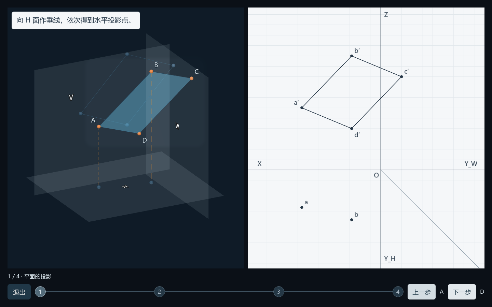
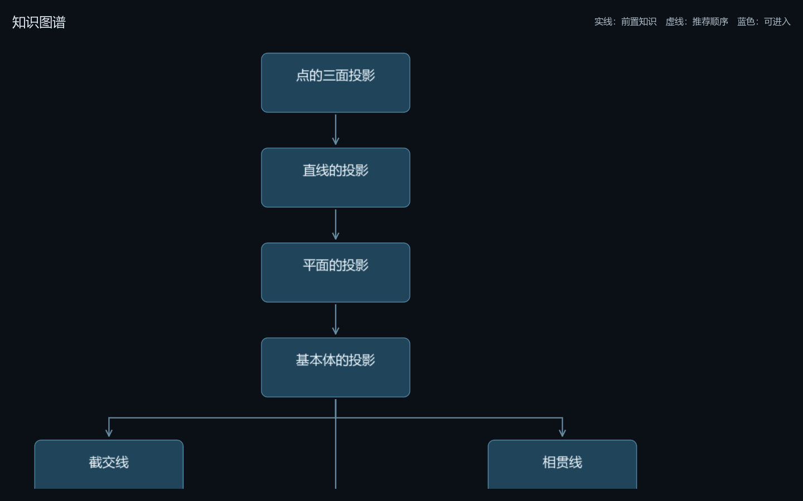
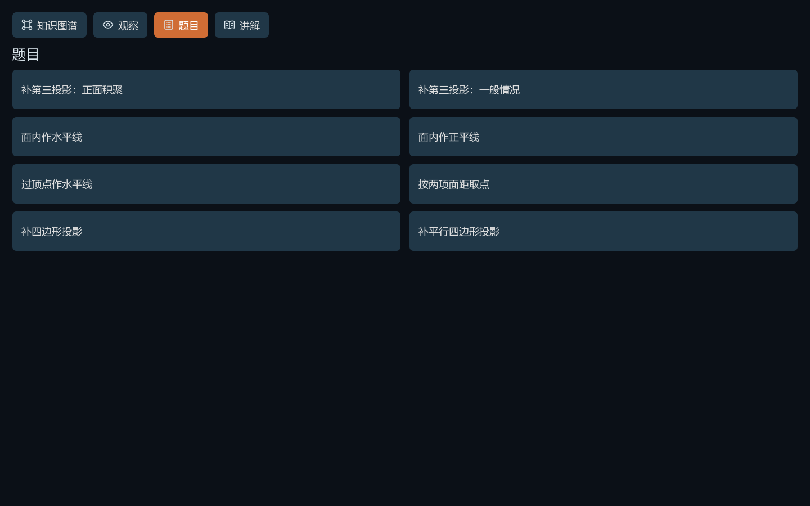
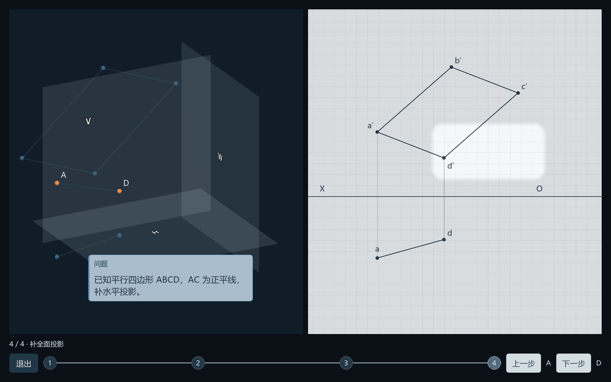
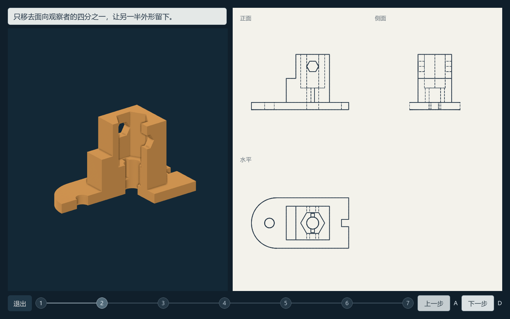
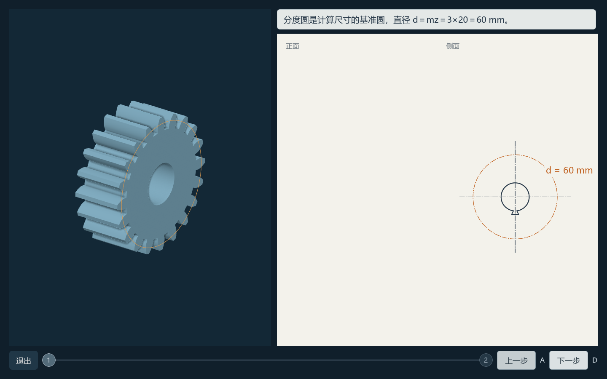

# Mechanical Drawing Learning

[中文](README.md) | **English**

Understand engineering-drawing concepts and construction procedures through **3D models, synchronized 2D projections, and step-by-step animation**.



## What it does

- **Observe**: rotate a spatial model and compare its corresponding orthographic views.
- **Explanation**: establish the object, givens and goal, then reveal the reasoning with short annotations and meaningful animation. Previously learned constructions run continuously.
- **Questions**: choose a representative problem by method and follow its construction, without an introductory reading of the entire question.
- **Knowledge map**: navigate 16 chapters organized around prerequisite relationships.

The current course contains **16 chapters, 420 explanation beats and 65 question entries representing 61 distinct tasks**. It is organized around 69 main questions and their subquestions in an existing 43-page, eight-paper collection. Representative demonstrations cover shared methods; this does not mean every source question has a separate animation. **The application UI and lesson text are currently Chinese.**

## Screenshots

These are actual application renders, not design mock-ups.

### A zoomable knowledge map



The screenshot shows part of the pannable, zoomable map.

### Method-based question selection



### Problem cards establish the givens and goal



### Section views connect material removal with engineering drawings



### Standard parts connect dimensions, structure and drawing conventions



## Run on Windows

Verified environment: **Windows, Godot 4.7.2, OpenGL Compatibility renderer**. Minimum window: 1060×720. Course data, models and drawings are included; engine binaries, system fonts, personal saves and import caches are excluded.

1. Clone this repository and obtain the standard Godot 4.7.x editor from the [official Godot website](https://godotengine.org/download/windows/).
2. Open PowerShell at the repository root:

```powershell
git clone https://github.com/jiangshirong/mechanical-drawing-learning.git
cd mechanical-drawing-learning
powershell -NoProfile -ExecutionPolicy Bypass -File .\tools\prepare_windows.ps1 -GodotPath "C:\Tools\Godot\Godot.exe"
```

Replace the example engine path. The preparation script copies the engine and Microsoft YaHei from your own Windows installation into local, Git-ignored folders. It does not download software or change system settings.

3. Run `机械制图学习/开始学习.cmd`, or open `机械制图学习/project.godot` in Godot, wait for the initial resource import, and run the project.

Learning does not require Python, Blender, Figma, an account, or an AI/MCP service. Other operating systems have not been validated; the Windows font preparation script is platform-specific.

## Controls

| Context | Action |
|---|---|
| Explanation / question walkthrough | **A**: previous; **D**: next; mouse buttons are also available |
| Text typing / animation playing | A or D completes the current phase; a subsequent input changes the beat |
| Section progress nodes | Jump to a section's beginning; exit remains available |
| 3D model in an explanation | Left-drag to rotate; stepping restores the teaching camera |
| Lesson text | Native selection and copying |
| Map and reference canvases | Mouse wheel to zoom; left-drag to pan |

The practice entry is hidden. There is no grading, learning analytics or online service. Original-source and reference buttons are developer tools: type `qwer` consecutively on the knowledge map to reveal them for the current run. Students can still view the question statement through the floating “题” button.

## Chapters

| Foundations and spatial construction | Solids and representation | Parts, annotations and drawing interpretation |
|---|---|---|
| Three-plane projection of points | Plane–solid intersections | Threads and threaded connections |
| Projection of lines | Solid–solid intersections | Spur gears |
| Projection of planes | Composite solids and missing views | Rolling bearings |
| Projection of basic solids | Sectional views | Dimensional and geometrical tolerances |
| | Removed sections | Surface roughness |
| | Dimensions and datums | Reading part drawings |

## Authoring and reuse

```text
机械制图学习/        Godot application, players, generated lessons and geometry
  模型/             Point/line/plane sources, registry and course data
  assets/           Shared-parameter scenes, GLB, drawings and source images
work/               Python authoring, domain geometry and verification scripts
docs/               Actual screenshots, verification summary and notices
学习资料/题集识别/   Question index and archived sources
```

New chapters share a lesson host, state machine and domain adapters; the existing point, line and plane controllers remain independent. Spatial geometry, projections, construction lines and measurements use shared parameters. Engineering drawing conventions are generated separately from mesh silhouettes. The public project does not enable the local AI editor integration; lesson behavior is preserved.

Python dependencies are needed only for authoring:

```powershell
python -m pip install -r requirements-authoring.txt
python work/build_exam_course.py --content-only
python work/check_exam_course.py
```

Use `python work/build_exam_course.py` for full geometry regeneration of the newer chapters. Rebuilding the original Blender assets additionally requires Blender. Line and plane sources retain their entry points: `work/build_line_learning.py`, `work/build_line_practice.py`, and `work/build_plane_lessons.py`. Change the authoring source rather than editing generated JSON alone.

Further documentation, currently Chinese: [capabilities](机械制图学习/当前课程能力清单.md), [coverage](机械制图学习/全卷知识覆盖表.md), [prerequisite and derivation review](机械制图学习/方法前置与推导审查.md), and [verification summary](docs/verification.md). Historical local QA screenshots, logs and environment records are not all distributed; the scripts can regenerate test outputs.

## Verification and limits

Verification covers normal/minimum-window renders, manual inspection of natural animation intermediate states, internal button/A/D events, stepping, section jumps, save restoration, cancellation and geometry constraints. Tests use isolated saves and offscreen windows without moving the system mouse.

This is teaching software, not manufacturing CAD or a general-purpose intersection solver. Native fullscreen, operating-system text-selection feel and real learner outcomes have not been validated. Teaching scales, original givens and source conflicts are recorded separately.

## Materials and licensing

Source questions, reference materials and third-party components retain their own rights and provenance. No blanket open-source license has been assigned to this project. Godot binaries and Windows system fonts are not redistributed. See [third-party notices](docs/THIRD_PARTY_NOTICES.md).
